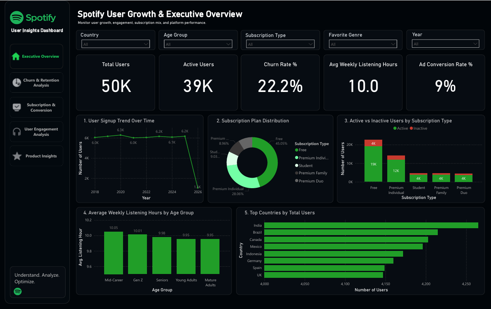
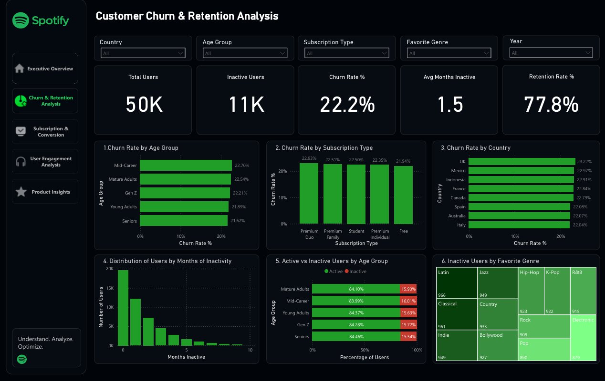
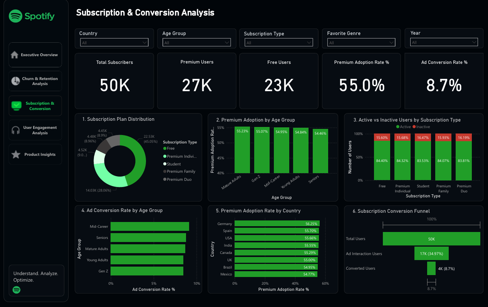
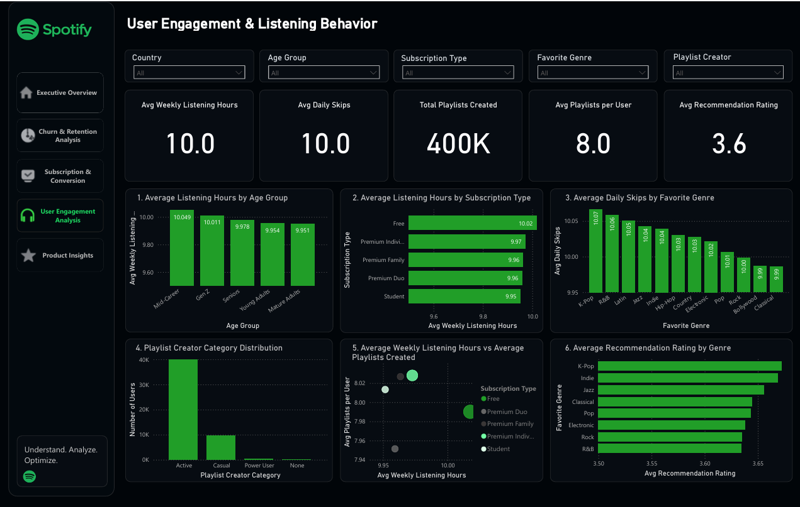

# 🎵 Spotify User Behavior Analysis | End-to-End Data Analytics Project

## Project Overview

This project is an end-to-end data analytics portfolio project that simulates the workflow of a Product or Growth Analyst working with a large-scale Spotify user dataset.

Starting from a raw dataset containing intentional data quality issues, the project demonstrates the complete analytics lifecycle:

- Data Quality Assessment
- Data Cleaning & Validation
- Feature Engineering
- Statistical Analysis
- Business Question Analysis
- Excel Pivot Table Reporting
- Interactive Power BI Dashboard Development

The objective is to transform raw user behavior data into actionable business insights related to user engagement, customer retention, subscription conversion, and product usage.

> **Note:** This is a self-directed portfolio project built using a synthetically generated Spotify-style dataset. The business scenario, stakeholder objectives, and recommendations simulate a real-world analytics environment.

---

# Dataset Overview

| Attribute | Value |
|-----------|-------|
| Dataset Type | Synthetic Spotify User Dataset |
| Total Records | 50,050 |
| Original Features | 18 |
| Cleaned Records | 50,020 |
| Missing Values | Present in 4 columns |
| Duplicate Records Removed | 30 |
| Dashboard Pages | 5 |
| Excel Worksheets | 9 |

---

# Business Objectives

The project answers several business questions commonly investigated by Product Analytics and Growth teams.

- Which customer segments experience the highest churn?
- How effective are Spotify advertisements at converting Free users to Premium?
- Which subscription plans have the highest adoption?
- How does user engagement vary across demographics?
- Which music genres receive the highest recommendation ratings?
- Which Spotify features are most valued by users?
- What future features are users requesting?
- Which customer behaviors should product teams prioritize?

---

# Project Workflow

## 1. Data Quality Assessment

The raw dataset was profiled before any cleaning was performed.

The assessment included:

- Missing value analysis
- Duplicate detection
- Invalid value identification
- Inconsistent categorical values
- Timeline validation
- Outlier detection
- Statistical summary

---

## 2. Data Cleaning

Each quality issue was addressed individually using documented business reasoning rather than blanket replacement rules.

Cleaning activities included:

- Removing duplicate records
- Standardizing categorical values
- Handling missing values
- Preserving meaningful null values
- Correcting inconsistent text formatting
- Flagging invalid dates
- Identifying outliers
- Creating data quality indicator columns

---

## 3. Feature Engineering

Additional analytical columns were created to improve reporting and segmentation.

Examples include:

- Age Group
- Playlist Creator Category
- Premium User Flag
- Churn Flag
- Conversion Flag
- Missing Rating Flag
- Invalid Signup Flag
- Outlier Flags

---

## 4. Statistical Validation

Rather than relying solely on visual observations, statistical hypothesis testing was performed to validate business findings.

Tests performed:

- Chi-Square Test
- One-Way ANOVA

Significance Level:

- α = 0.05

Several apparent differences observed in visualizations were tested and found **not statistically significant**, ensuring conclusions were supported by evidence rather than assumptions.

---

## 5. Business Analysis

Business questions were answered using:

- Excel Pivot Tables
- KPI calculations
- Comparative analysis
- Executive summaries
- Business recommendations

---

## 6. Dashboard Development

The cleaned dataset was imported into Power BI to develop a multi-page interactive dashboard.

Dashboard Pages:

1. Executive Overview
2. Churn & Retention Analysis
3. Subscription & Conversion Analysis
4. User Engagement Analysis
5. Product Insights & Recommendations

---

# Tools & Technologies

| Tool | Purpose |
|------|----------|
| Python | Data Cleaning, Feature Engineering, Statistical Analysis |
| Pandas | Data Manipulation |
| NumPy | Numerical Operations |
| SciPy | Statistical Testing |
| Jupyter Notebook | Cleaning Documentation |
| Microsoft Excel | Pivot Tables, KPI Analysis, Business Reporting |
| Power BI | Interactive Dashboard Development |
| Git & GitHub | Version Control & Portfolio |

---

# Repository Structure

```text
spotify-user-behavior-analysis/
│
├── data/
│   ├── raw_spotify_dataset.csv
│   └── cleaned_spotify_dataset.csv
│
├── notebooks/
│   └── 01_data_cleaning.ipynb
│
├── excel/
│   └── spotify_analysis.xlsx
│
├── dashboard/
│   ├── Spotify Analysis.pbix
│   └── Spotify Analysis.pdf
│
├── screenshots/
│   ├── page1_executive_overview.png
│   ├── page2_churn_retention.png
│   ├── page3_subscription_conversion.png
│   ├── page4_user_engagement.png
│   └── page5_product_insights.png
│
├── README.md
└── LICENSE
```

---

# Key Findings

- Approximately **22%** of users are inactive, indicating a retention opportunity.
- Premium users account for approximately **55%** of the user base, while the Free plan remains the largest individual subscription tier.
- Advertisement-to-subscription conversion remains below **10%**, suggesting room for optimization.
- User engagement metrics remain relatively consistent across age groups, subscription plans, and listening preferences.
- Nearly **40%** of users did not provide feature requests, meaning product feedback represents only participating users.
- Recommendation ratings remain relatively stable across music genres, indicating generally consistent recommendation performance.

---

# Dashboard KPIs

The dashboard monitors:

- Total Users
- Active Users
- Inactive Users
- Churn Rate
- Retention Rate
- Premium Adoption Rate
- Advertisement Conversion Rate
- Average Weekly Listening Hours
- Average Recommendation Rating
- Average Daily Skips
- Average Playlists Created

---

# Data Quality Summary

The raw dataset intentionally contained multiple quality issues commonly encountered in production environments.

Examples include:

- Missing values
- Duplicate records
- Invalid ages
- Negative listening hours
- Negative playlist counts
- Inconsistent country names
- Inconsistent device names
- Future signup dates
- Extreme outliers

Each issue was documented and resolved through a transparent cleaning process before analysis.

---

# Project Deliverables

- Cleaned analytical dataset
- Data cleaning notebook
- Data quality documentation
- Feature engineering workflow
- Excel business analysis workbook
- Executive summary
- KPI definitions
- Pivot table analysis
- Power BI dashboard
- Business recommendations

---

# Limitations

- Dataset is synthetically generated and does not represent real Spotify users.
- Statistical findings demonstrate analytical methodology rather than actual business performance.
- Missing recommendation ratings and demographic information were intentionally preserved where imputation would introduce unsupported assumptions.
- Product feedback analysis represents only users who voluntarily submitted responses.

---

# How to Reproduce

1. Clone the repository.

```bash
git clone https://github.com/AKHIL572/spotify-user-insights-powerbi
```

2. Open the Jupyter Notebook.

```
01_data_cleaning.ipynb
```

3. Run all notebook cells to regenerate the cleaned dataset.

4. Open the Excel workbook.

```
spotify_analysis.xlsx
```

5. Open the Power BI dashboard.

```
Spotify Analysis.pbix
```

---

# Dashboard Preview

## Executive Overview



---

## Churn & Retention Analysis



---

## Subscription & Conversion Analysis



---

## User Engagement Analysis



---

## Product Insights


---

## Author

**Akhil T V**

Aspiring Data Analyst

Skills demonstrated in this project:

- Data Cleaning
- Exploratory Data Analysis
- Feature Engineering
- Statistical Analysis
- Business Intelligence
- Excel Analytics
- Power BI Dashboard Development
- Business Storytelling