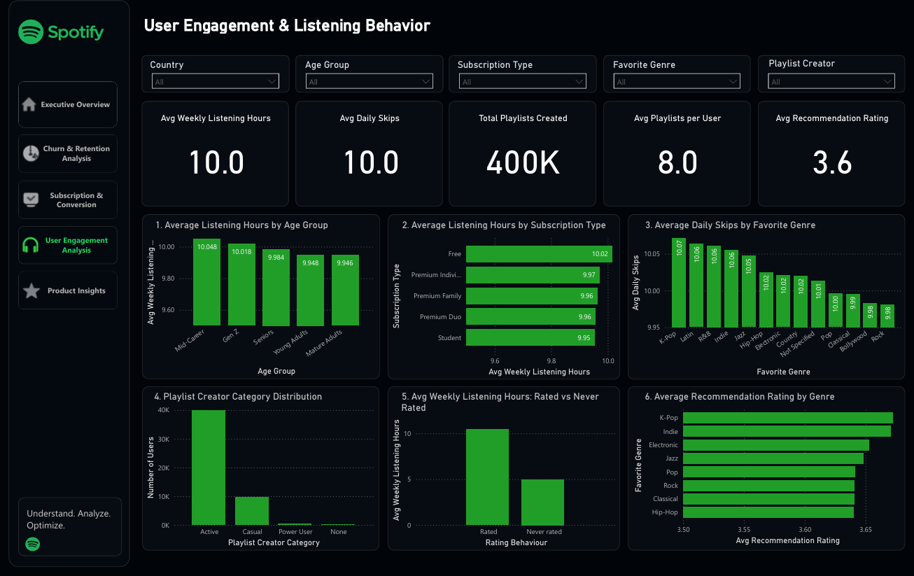
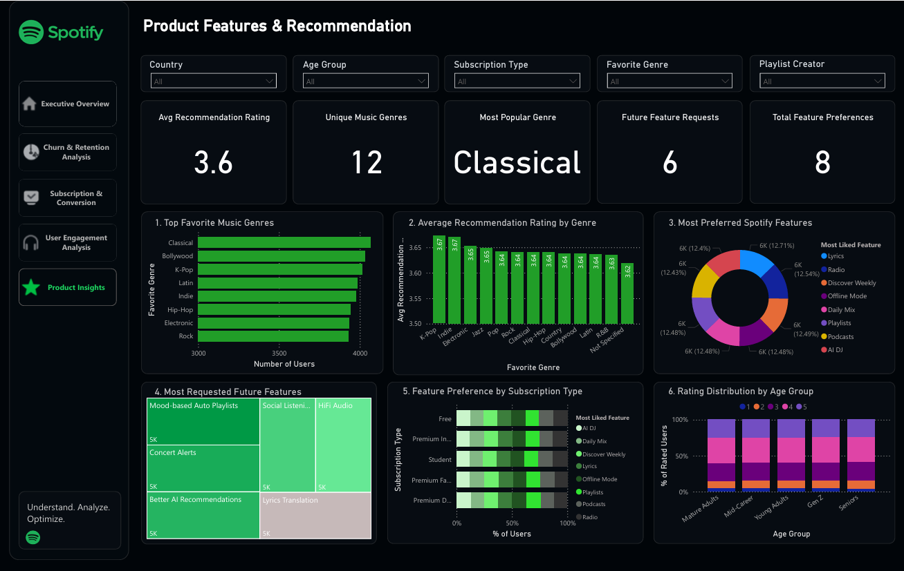

# 🎵 Music Streaming Subscriber Analytics: Churn, Conversion & Engagement

**End-to-end data analytics project: Python, Excel and Power BI on a Spotify-style user dataset**

## Project Overview

This project follows the workflow of a Product or Growth Analyst working with a 50,000-user music streaming dataset. Starting from a raw file with data quality problems, it covers the full analytics lifecycle:

- Data quality assessment
- Data cleaning and validation
- Feature engineering
- Statistical hypothesis testing
- Business question analysis in Excel
- A five-page interactive Power BI dashboard

The goal is to turn raw user records into clear answers about retention, subscription conversion, engagement and product usage, and to be honest about what the data can and cannot support.

> **Note:** This is a self-directed portfolio project. The data is a free, public Spotify-style dataset from Kaggle that appears to be synthetic, so it is not real Spotify data. The business scenario and objectives are simulated.

---

# Dataset Overview

| Attribute | Value |
|-----------|-------|
| Source | Public Kaggle dataset (Spotify-style, appears synthetic) |
| Raw records | 50,050 |
| Original features | 18 |
| Cleaned records | 50,020 (30 exact duplicates removed) |
| Cleaned columns | 35 (18 original + 10 data-quality flags + 7 derived) |
| Columns with missing values | 4 |
| Statistical tests run | 6 |
| Dashboard pages | 5 |
| Excel worksheets | 10 |

---

# Business Objectives

- Which customer segments have the highest churn, and are the differences real?
- How effective are ads at converting users to subscribers?
- Which subscription plans have the highest adoption?
- How does engagement vary across demographics and plans?
- Which genres get the highest recommendation ratings?
- Which features do users value, and which do they request?
- Which user behaviors signal disengagement?

---

# Project Workflow

## 1. Data Quality Assessment

The raw file was fully profiled **before any change was made**: missing values, exact and near-duplicate records, impossible values, inconsistent text, the valid signup window, outliers, and logical conflicts between fields.

## 2. Data Cleaning

Every issue was handled individually, with the reason documented in the notebook, instead of one blanket rule. Only exact duplicate rows were deleted. Everything else was corrected with a stated reason or kept and marked with a `flag_*` column, so any analysis can include or exclude those rows on purpose.

## 3. Feature Engineering

- **Segments:** Age Group, Listening Hour Category, Playlist Creator Category, signup Month and Year
- **Metrics:** Premium flag, Churn flag (account status)
- **10 data-quality flags:** invalid age, negative value corrected, listening-hour outlier, playlist outlier, no rating given, duplicate profile, signup outside the observed window, conversion on Free plan, Active but inactive 3+ months, zero listening

## 4. Statistical Validation

Visual differences between groups were tested before being treated as findings.

- **Tests:** Chi-square test of independence and one-way ANOVA, at a significance level of α = 0.05
- **Effect sizes:** Cramér's V and eta-squared, reported next to each p-value, because with 50,000 users even tiny differences can reach significance

| Comparison | Test | p-value | Effect size |
|---|---|---|---|
| Churn (account status) by plan | Chi-square | 0.559 | 0.008 |
| Churn (account status) by country | Chi-square | 0.507 | 0.014 |
| Churn (inactive 3+ months) by plan | Chi-square | 0.582 | 0.008 |
| Churn (inactive 3+ months) by country | Chi-square | 0.240 | 0.017 |
| Avg recommendation rating by genre | ANOVA | 0.908 | 0.0001 |
| Avg listening hours by age group | ANOVA | 0.260 | 0.0001 |

**None of the six comparisons is statistically significant**, and every effect size is far below the conventional "small" threshold. The groups are effectively the same, so the dashboard charts that compare them are descriptive only.

## 5. Business Analysis

A 10-sheet Excel workbook holds an executive summary, KPI definitions, six business questions with formula-driven answers, summary tables for churn, subscriptions, engagement, product insights and signup trend, a data quality log, and the cleaned data. The summary tables are built with `COUNTIFS` / `AVERAGEIFS` formulas, so they recalculate automatically.

## 6. Dashboard Development

The cleaned dataset powers a five-page Power BI dashboard:

1. Executive Overview
2. Churn & Retention Analysis
3. Subscription & Conversion Analysis
4. User Engagement Analysis
5. Product Insights & Recommendations

---

# Metric Definitions

Some metrics can be defined more than one way, so each dashboard card uses one labeled definition.

| Metric | Definition | Value |
|---|---|---|
| Churn rate | `months_inactive >= 3` (inactive 3+ months) / all users | 22.2% |
| Account-status churn | `subscription_status = Inactive` / all users | 15.8% |
| Premium adoption | Any plan other than Free (Student counts as paid) | 54.9% |
| Ad conversion (all users) | `ad_conversion_to_subscription = Yes` / all users | 8.7% |
| Ad conversion (ad-interacted) | Conversion Yes / users who interacted with ads | 24.9% |
| Ad conversion (confirmed on a paid plan) | Conversion Yes and on a paid plan / all users | 4.9% |

---

# Key Findings

- **Churn:** 22.2% of users have been inactive for 3+ months (15.8% have an Inactive account status). Differences between plans and countries are not statistically significant.
- **Subscriptions:** 54.9% of users are on a paid plan, and Free is the largest single plan at 45.1%.
- **Ads:** 35.0% of users interact with ads, and 8.7% of all users (24.9% of ad-interacted users) show an ad conversion. Counting only conversions confirmed on a paid plan, it is 4.9%.
- **Engagement:** average listening is about 10 hours a week, and it is almost identical across age groups and plans.
- **Ratings:** average recommendation rating is 3.64, and genres range only from 3.63 to 3.67.
- **A real behavioral signal:** users who never rate recommendations listen about 5.0 hours a week versus 10.5 for users who do. Missing ratings mark low engagement, which is why they were left blank and not filled with an average.
- **Product feedback:** about 40% of users gave no future-feature request, so requests reflect only participating users. Feature preferences are almost evenly split.

---

# Recommendations

These follow from the evidence above and describe associations in this dataset, not proven causes.

1. **Do not target retention effort by plan, country or age group.** The tests show no real differences between them.
2. **Report churn with one clearly named definition.** 3,234 users are "Active" by status but inactive for 3+ months, so the two measures disagree.
3. **Clean up conversion tracking.** 1,925 users are marked as converted while still on the Free plan, which inflates the headline conversion rate.
4. **Treat a missing recommendation rating as an early warning.** Those users listen about half as much, so prompting for feedback or re-engaging them is a reasonable first test.
5. **Improve feedback collection.** With about 40% non-response, feature requests are a biased sample.

---

# Data Quality Summary

| Issue | Rows | Handling |
|---|---|---|
| Exact duplicate rows | 30 | Removed |
| Near-duplicate profiles (same data, different user ID) | 40 (20 pairs) | Kept and flagged |
| Missing values | `age` 1,751; `rating` 4,372; `genre` 2,504; `desired feature` 20,021 | Age and rating left null; genre and feature given a clear placeholder |
| Impossible ages (<10 or >100) | 25 | Set to null and flagged |
| Negative listening hours / playlist counts | 15 / 10 | Absolute value, flagged |
| UK under four spellings | 3,099 rows differed from the standard | Standardized |
| Inconsistent device name casing | 2,643 | Standardized |
| Signup dates outside the continuous signup window | 20 | Kept, flagged, excluded from time trends |
| Extreme values (>100 hrs/week or >150 playlists) | 22 | Kept and flagged |
| Conversion = Yes while on the Free plan | 1,925 | Kept and flagged |
| Status Active but inactive 3+ months | 3,234 | Kept and flagged |

---

# Tools & Technologies

| Tool | Purpose |
|------|---------|
| Python | Data cleaning, feature engineering, statistical testing |
| Pandas, NumPy | Data manipulation |
| SciPy | Chi-square and ANOVA tests |
| Jupyter Notebook | Documented cleaning and testing workflow |
| Microsoft Excel | Formula-driven summary tables, KPI definitions, business questions, data quality log |
| Power BI | Interactive dashboard |
| Git & GitHub | Version control and portfolio |

---

# Repository Structure

```text
spotify-user-insights-powerbi/
│
├── data/
│   ├── raw_spotify_dataset.csv
│   └── cleaned_spotify_dataset.csv
│
├── notebooks/
│   └── 01_data_cleaning_and_testing.ipynb
│
├── excel/
│   └── Spotify Analysis Workbook.xlsx
│
├── dashboard/
│   ├── Spotify Analysis.pbix
│   └── Spotify Analysis.pdf
│
├── screenshots/
│   ├── page1_executive_overview.png
│   ├── page2_churn_retention.png
│   ├── page3_subscription_conversion.png
│   ├── page4_user_engagement.png
│   └── page5_product_insights.png
│
├── README.md
└── .gitignore
```

---

# How to Reproduce

1. Clone the repository.

```bash
git clone https://github.com/AKHIL572/spotify-user-insights-powerbi
cd spotify-user-insights-powerbi
```

2. Install the Python libraries.

```bash
pip install pandas numpy scipy jupyter
```

3. Open `notebooks/01_data_cleaning_and_testing.ipynb` and run all cells. The notebook reads `data/raw_spotify_dataset.csv` and regenerates `data/cleaned_spotify_dataset.csv`.

4. Open `excel/Spotify Analysis Workbook.xlsx`. If the cleaned data changes, paste the new CSV into its `Data` sheet and the summary tables recalculate.

5. Open `dashboard/Spotify Analysis.pbix` in Power BI Desktop. If prompted, point the data source to `data/cleaned_spotify_dataset.csv` and refresh.

---

# Limitations

- **The data appears to be synthetic.** Country, genre, device and feature categories are almost evenly split and valid ages run only from 16 to 60. Findings describe this dataset, not real Spotify users.
- **No cause-and-effect conclusions.** The data is a single snapshot with no event timeline, so it supports description and association only.
- **Two churn measures exist** because the account status and the 3-month activity field disagree for 3,234 users. The dashboard uses the 3-month measure and labels it.
- **Field conflicts were flagged, not repaired**, because the source has no history that shows what happened (for example, 1,925 Free-plan users marked as converted).
- **Negative values were corrected with the absolute value**, on the assumption of a sign error. The 25 affected rows are flagged and can be excluded.
- **The signup window is inferred from the data.** Signups run continuously until 2026-03-01, so 2026 holds only about two months of data and is not comparable with full years.
- **Missing ratings and ages were left blank** on purpose, because filling them would invent unsupported values.
- **Feature requests** come only from users who chose to answer.

---

# Dashboard Preview

## Executive Overview


---

## Churn & Retention Analysis


---

## Subscription & Conversion Analysis


---

## User Engagement Analysis



---

## Product Insights



---

## Author

**Akhil T V**

Aspiring Data Analyst

Skills demonstrated in this project:

- Data cleaning and validation
- Exploratory data analysis
- Feature engineering
- Statistical analysis
- Excel analytics
- Power BI dashboard development
- Business storytelling